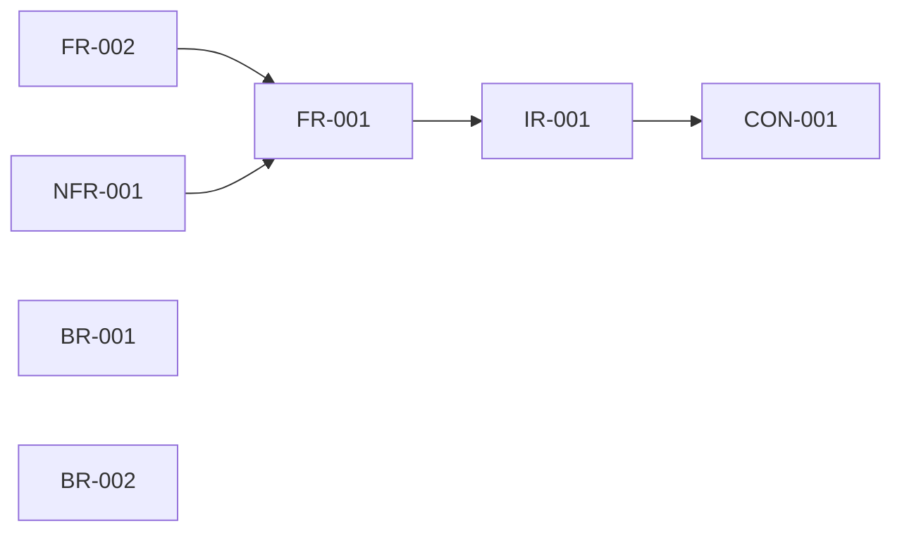

# Traceability — Brightsmile Dental online booking

> Generated from `requirements/requirements.json` (run 2026-10-10T09:00Z). Do not edit this file by hand; change the JSON and regenerate.

## Dependency graph

An arrow points from an item to the item it depends on.

## Story → requirement matrix

| Story | Requirement | Type | Origin | Questions | Risks |
|---|---|---|---|---|---|
| US-001 | FR-001 Book an appointment online | FUNCTIONAL | **[Explicit]** | Q-002, Q-003, Q-004, Q-005, Q-007, Q-009 | RISK-003 |
| US-001 | FR-002 Send booking confirmation email | FUNCTIONAL | **[Explicit]** | Q-005, Q-006, Q-008 | RISK-003 |
| US-001 | BR-001 Booking window of 24 hours to 60 days | BUSINESS_RULE | **[Explicit]** | — | — |
| US-001 | BR-002 A booked slot is no longer free | BUSINESS_RULE | **[Explicit]** | — | RISK-002 |
| US-001 | NFR-001 Booking page load time | NON_FUNCTIONAL | **[Unknown]** | Q-001 | RISK-004 |
| US-001 | CON-001 ClinicDesk remains the master calendar | CONSTRAINT | **[Explicit]** | — | RISK-001 |
| US-001 | IR-001 Read availability from and write bookings to ClinicDesk | INTEGRATION | **[Inferred]** | Q-008 | RISK-001, RISK-002 |
