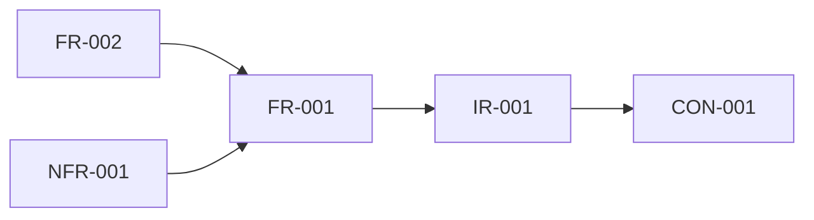

# Worked example: US-001 after steps 7–9

- Input: the step 6 output, `business-rules-extraction/references/worked-example.draft.json`.
- Output: [worked-example.draft.json](worked-example.draft.json).

## Step 7: scope

All seven items are **IN**:
- **Stated in US-001:** FR-001, FR-002, BR-001, BR-002, NFR-001 and CON-001.
- **IR-001:** follows from CON-001 and is needed for FR-001 to work.

Cancellation and reminders are **not** marked OUT. They aren't requirements; they are open questions (Q-006, Q-007). The client hasn't said "no", so the agent doesn't decide for them.

## Step 8: dependencies

- FR-002 → FR-001: the confirmation reacts to the booking.
- NFR-001 → FR-001: it measures the booking page.
- BR-001 and BR-002 attach to FR-001 through `business_rules`, not `dependencies`.
- No cycles.

## Step 9: risks

| ID | Category | L / I | Cause in the draft | Mitigation |
|---|---|---|---|---|
| RISK-001 | INTEGRATION | MEDIUM / HIGH | IR-001 assumes ClinicDesk can supply free slots and accept new bookings | Confirm API access and terms with the vendor; run a short technical spike |
| RISK-002 | TECHNICAL | MEDIUM / MEDIUM | Two booking channels write to one calendar, which threatens BR-002 | Commit bookings only in ClinicDesk; re-check at confirmation (Q-008) |
| RISK-003 | COMPLIANCE | HIGH / HIGH | CRITICAL gap: healthcare data with an unknown regime (Q-005) | Get the jurisdiction from the client before architecture work |
| RISK-004 | REQUIREMENT_QUALITY | HIGH / MEDIUM | NFR-001 target is UNKNOWN | Agree a target via Q-001 before approval |

Back-links in `requirements[].risks`:

| Requirement | Risks |
|---|---|
| IR-001 | RISK-001, RISK-002 |
| CON-001 | RISK-001 |
| BR-002 | RISK-002 |
| FR-001 | RISK-003 |
| FR-002 | RISK-003 |
| NFR-001 | RISK-004 |

Considered and not recorded:
- **SCALABILITY:** a single practice has low volume.
- **SECURITY:** it shares its cause with RISK-003 and the AUTH gap, so it is not logged twice.
